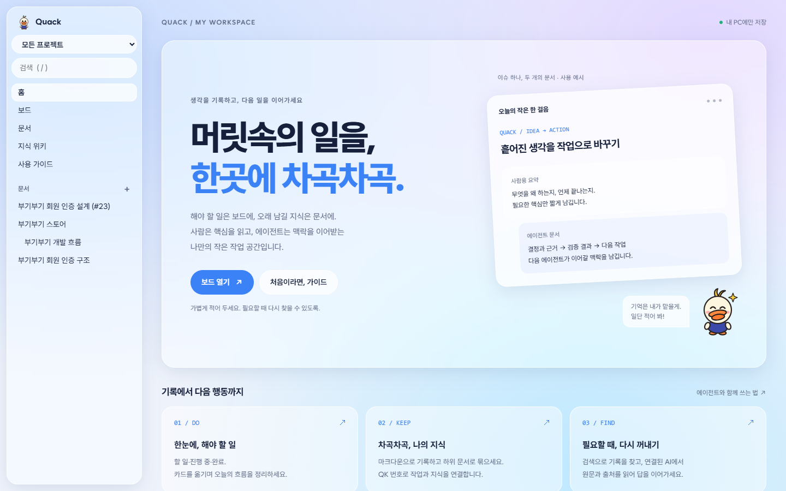
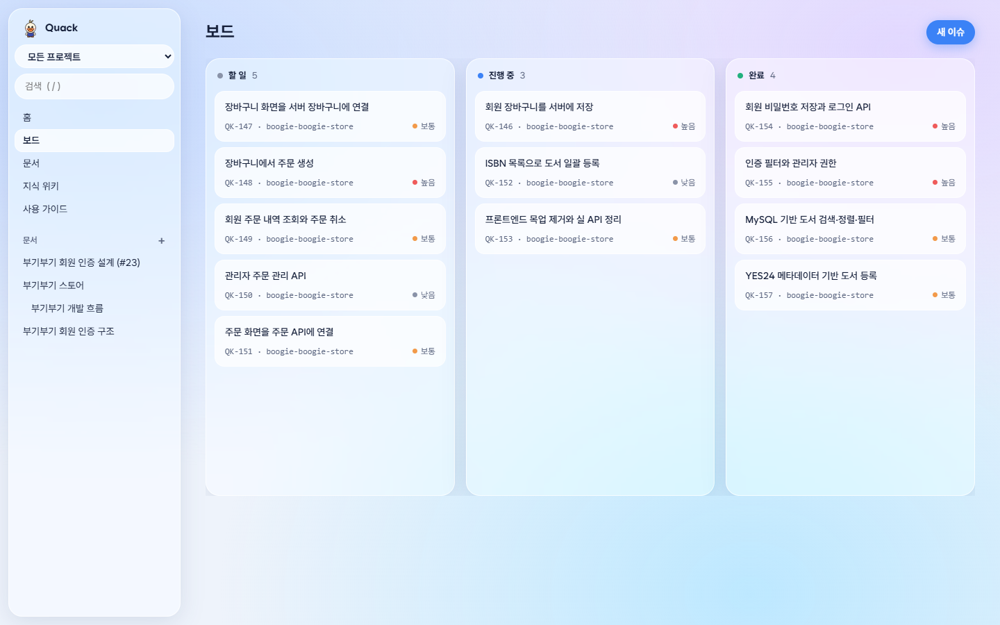
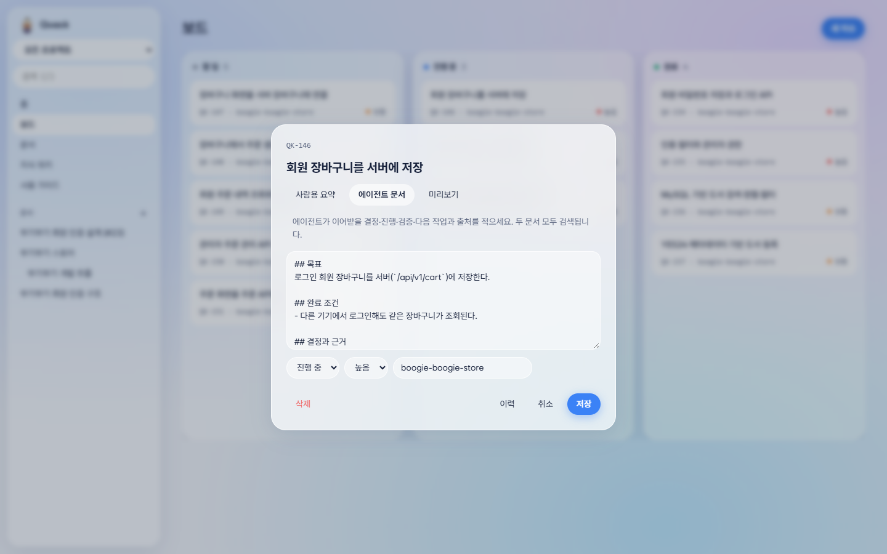
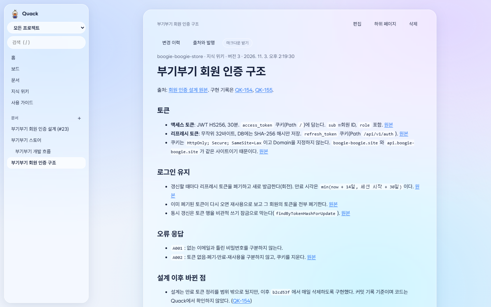
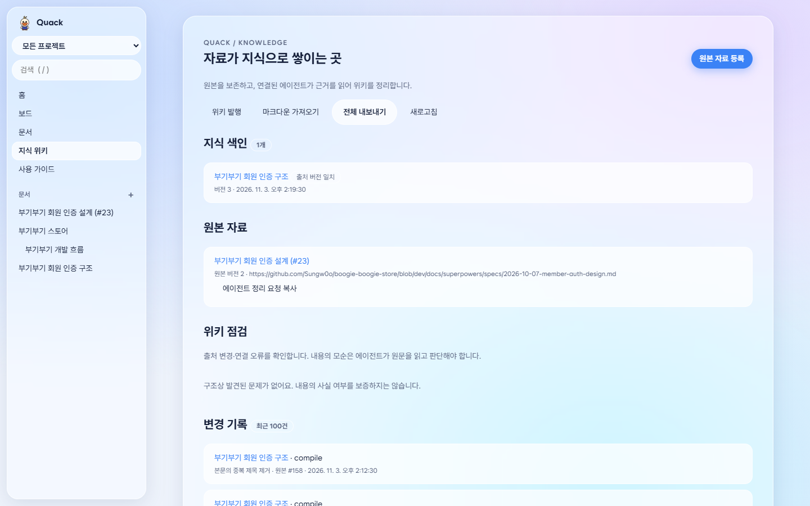
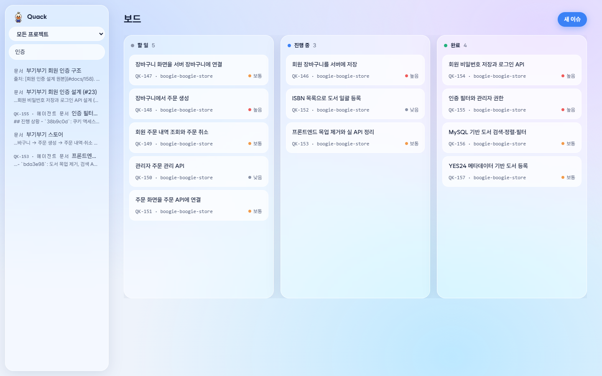
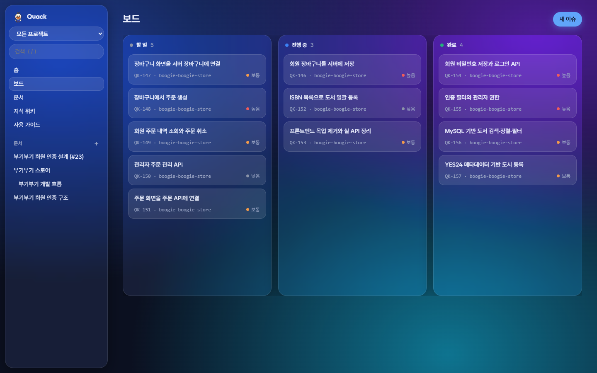

# Quack 꽥

나 혼자 쓰는 로컬 "두 번째 뇌". 칸반 보드(Jira), 마크다운 위키(Confluence/Notion), 그리고 Claude·Codex가 그 내용을 찾아 답하는 RAG를 한곳에 모았다. 프로젝트를 여러 개 굴리면서 이슈를 관리하고, AI 에이전트가 이전 작업을 이어받기 쉽게 만드는 것이 목적이다.

- 앱은 저장하고 검색만 한다. 답은 Claude(구독)나 Codex가 **MCP**로 Quack을 검색하고 읽어서, 출처를 달아 만든다. 앱에 API 키나 LLM 호출은 없다.
- PC 안에서만 돈다. 포트는 `127.0.0.1`에만 열리고, 로그인 같은 건 없다.
- 앱의 **사용 가이드** 메뉴에서 [사람용 가이드](src/main/resources/static/user-guide.md)와 [에이전트 가이드](src/main/resources/static/agent-guide.md)를 읽고 마크다운으로 받을 수 있다.

## 할 수 있는 것
| 기능 | 내용 |
|---|---|
| **보드** | 할 일 / 진행 중 / 완료 칸반. 드래그로 상태를 바꾸고, 이슈 키는 `QK-12` 형식이다 |
| **프로젝트** | 사이드바 맨 위에서 고르면 보드·문서·검색·지식 위키가 그 프로젝트만 보여 주고, 새 항목도 그 프로젝트로 들어간다. REST·MCP도 `project`로 거른다 |
| **이슈 문서 2개** | `사람용 요약`에는 목적·완료 조건을, `에이전트 문서`에는 결정·진행·검증·다음 작업과 출처를 적는다. 저장에 실패하면 두 초안을 유지한다 |
| **문서** | 마크다운 위키. 하위 페이지로 계층을 만들고, 본문의 `QK-12`는 이슈 링크가 된다 |
| **지식 위키** | 원본 자료와 정리된 지식을 나눈다. 원본 중복 감지, 출처·역방향 연결, 색인·발행 기록·재검토 표시·구조 점검. 완료 이슈는 **위키로 남기기**로 보존한다 |
| **검색** | `/`로 이슈·문서·에이전트 문서를 한 번에 키워드 검색한다. 일치한 부분의 발췌를 보여 준다 |
| **안전한 수정** | 읽은 버전이 다르면 저장을 막고 초안과 최신 내용을 비교한다. 변경 이력에서 과거 내용을 새 버전으로 복원한다 |
| **입출력** | .md/.txt 가져오기, 개별 Markdown·전체 Markdown ZIP 내보내기. DB 백업을 대신하지는 않는다 |
| **AI 연동 (MCP)** | Claude·Codex가 도구 10개로 찾고, 읽고, 만들고, 고치고, 위키를 발행한다. 프롬프트 3개로 원본 정리·Notion 가져오기·GitHub 회고를 부른다. 삭제 도구는 일부러 없다 |
| **다크 모드** | 시스템 설정을 따라 라이트·다크가 바뀐다 |
| **단축키** | `/` 검색, `n` 새로 만들기, `Ctrl+S` 문서 저장, `Esc` 편집 취소 |

## 화면
| 홈 | 보드 |
|---|---|
|  |  |
| **이슈: 사람용 요약과 에이전트 문서** | **문서: 출처가 달린 위키** |
|  |  |
| **지식 위키: 색인·원본·점검·기록** | **검색: 이슈·문서·에이전트 문서 한 번에** |
|  |  |
| **다크 모드** | |
|  | |

## 빠른 시작

### 1. 준비물
| 필요한 것 | 어디에 쓰나 |
|---|---|
| [Docker Desktop](https://www.docker.com/products/docker-desktop/) | 앱과 DB 실행. **필수** |
| [Git](https://git-scm.com/) (Windows는 Git Bash 포함) | 클론, `quack smoke` |
| [Node.js](https://nodejs.org/) 18 이상 | 테스트 스크립트, Claude Desktop 중계, 전역 MCP 등록 |
| 비어 있는 포트 **8765**(앱), **15432**(DB) | 다른 프로그램이 쓰고 있으면 `docker-compose.yml`에서 바꾼다 |

Java나 Gradle은 따로 설치하지 않아도 된다. 빌드는 Docker 안에서 한다. 재부팅 뒤에도 자동으로 뜨게 하려면 Docker Desktop의 Settings → General → "Start Docker Desktop when you sign in"을 켠다.

### 2. 받기
```bash
git clone https://github.com/Sungw0o/Queck.git quack
```
```bash
cd quack
```

### 3. 실행
**Windows**: 폴더에서 `quack.bat`을 더블클릭하거나 터미널에서 실행한다.
```bash
quack
```
PowerShell에서는 `.\quack`이다. 이미지를 빌드해서 띄우고, 앱이 응답하면 http://localhost:8765 를 연다. 첫 빌드는 몇 분 걸린다.

**macOS / Linux**: `quack.bat` 대신 compose를 직접 쓴다.
```bash
docker compose up -d --build
```
1~2분 뒤 http://localhost:8765 를 연다.

### 4. 멈추기
```bash
quack stop
```
macOS / Linux는 `docker compose stop`. 데이터는 Docker 볼륨 `quack_pgdata`에 그대로 남는다.

## 명령 모음 (`quack.bat`)
Windows용 도우미다. 다른 OS는 오른쪽 열의 명령을 쓴다.

| 명령 | 하는 일 | macOS / Linux |
|---|---|---|
| `quack` | 빌드, 실행, 브라우저 열기 | `docker compose up -d --build` |
| `quack stop` | 멈춤 (데이터는 그대로) | `docker compose stop` |
| `quack logs` | 앱 로그 보기 | `docker compose logs -f app` |
| `quack db` | DB만 띄우기 (IDE에서 앱을 돌릴 때) | `docker compose up -d db` |
| `quack backup` | DB를 `backups/`에 덤프하고 30일 지난 덤프는 정리 | 아래 "백업과 복원" |
| `quack schedule` | 매일 12:00 자동 백업을 작업 스케줄러에 등록 | cron 등으로 직접 |
| `quack desktop` | Claude Desktop에 Quack MCP 등록 | 아래 "Claude Desktop" |
| `quack global` | 다른 폴더에서도 Quack·Notion·GitHub MCP를 쓰도록 전역 등록 (`--dry-run`은 미리보기) | `node scripts/register-global.mjs` |
| `quack smoke` | 실행 중인 앱에 스모크 테스트 | `bash scripts/smoke.sh` |

## 테스트 스크립트
모두 `scripts/`에 있고, 저장소 폴더에서 실행한다. 테스트가 만든 데이터는 실패해도 지우므로 실제 DB에 돌려도 된다.

**앱 없이 돌리는 검사** (Node만 있으면 된다)
```bash
node scripts/guard.test.mjs
```
```bash
node scripts/issue-preview.test.mjs
```
```bash
node scripts/navigation.test.mjs
```
| 스크립트 | 검사 내용 |
|---|---|
| `guard.test.mjs` | AI 에이전트의 위험 명령 차단 규칙 |
| `issue-preview.test.mjs` | 이슈 창의 두 문서 전환, 초안 유지, 저장 실패 처리 |
| `navigation.test.mjs` | 홈·가이드 이동과 가이드 파일 로딩 |

**실행 중인 앱에 돌리는 검사** (먼저 `quack`으로 띄운다)
```bash
bash scripts/smoke.sh
```
REST 생성·수정·한글 검색·404·하위 페이지 삭제, MCP 도구 10개·프롬프트 3개, 프로젝트 구분, 충돌·이력·위키 발행, Claude Desktop 중계까지 한 번에 본다. Node가 있으면 아래 세 스크립트도 이어서 실행한다. 따로 돌릴 수도 있다.

| 스크립트 | 검사 내용 |
|---|---|
| `node scripts/rag-smoke.mjs` | 이슈 두 문서 저장, 에이전트 문서 검색·출처 링크, MCP `create`→`search`→`get`→`update` |
| `node scripts/knowledge-smoke.mjs` | 원본 등록·중복, 위키 발행·점검·이력·복원, 지식화 |
| `node scripts/rag-eval.mjs` | 고정된 검색 평가 10문항. 검색 근거 평가이며 LLM 답변의 사실성은 재지 않는다 |

다른 주소에 띄웠다면 주소를 인자로 준다. 예: `bash scripts/smoke.sh http://localhost:8080`

GitHub Actions(`.github/workflows/ci.yml`)도 push마다 같은 검사를 돌린다.

## AI 연결
Claude Code, Codex, Claude Desktop 세 군데서 쓸 수 있다. 앱이 떠 있어야 하고(MCP 주소 `http://localhost:8765/mcp`), 작업 규칙은 셋 다 [AGENTS.md](AGENTS.md)를 따른다.

### Claude Code
이 폴더에서 Claude Code를 열면 `.mcp.json`으로 자동 연결된다. 처음 한 번 `quack` 서버 사용을 승인한다. 자주 하는 작업은 프롬프트로 부른다.

| 프롬프트 | 하는 일 |
|---|---|
| `/mcp__quack__organize_source` | 원본 자료를 출처가 달린 지식 위키로 정리 |
| `/mcp__quack__import_notion` | Notion 페이지를 고치지 않고 Quack 원본으로 저장 |
| `/mcp__quack__github_retro` | GitHub PR·이슈를 원본으로 남기고 배운 점을 위키로 정리 |

### Codex
이 폴더에서 Codex를 열면 `.codex/config.toml`로 연결된다. 처음 열 때 묻는 **프로젝트 신뢰**와 **훅 신뢰**를 허용해야 MCP와 가드가 켜진다. `search`, `get`, `wiki_context`, `history`는 읽기 전용이라 묻지 않고 실행하고, 생성·수정·발행·복원은 매번 승인을 묻는다. 그래서 `codex exec` 같은 비대화형 실행에서는 쓰기 도구가 실패한다.

### 외부 계정 (Notion, GitHub)
Claude Code와 Codex는 이 폴더에서 Notion·GitHub 공식 MCP에도 연결된다. 토큰은 파일에 넣지 않는다. 쓰지 않으면 무시해도 되고, Quack 연결에는 영향이 없다.
- **Notion**: OAuth. Claude Code는 `/mcp`에서 `notion`을 골라 로그인하고, Codex는 `codex mcp login notion`을 실행한다.
- **GitHub**: [PAT](https://github.com/settings/personal-access-tokens)를 만들어 사용자 환경변수 `GITHUB_PAT`에 넣고 Claude Code·Codex를 다시 연다. 권한은 필요한 저장소와 범위만 준다. 비어 있으면 `github` 서버만 연결에 실패한다.
- Claude Desktop의 Notion은 Desktop 설정의 커넥터로 붙인다.

### 다른 프로젝트 폴더에서 쓰기
위 연결은 이 폴더에서만 켜진다. 다른 저장소에서 작업할 때도 Quack을 쓰려면 전역으로 등록한다. 먼저 미리보기로 추가될 서버를 확인한다.
```bash
quack global --dry-run
```
```bash
quack global
```
- Claude Code는 user 범위(`~/.claude.json`), Codex는 `~/.codex/config.toml`에 이 저장소의 `.mcp.json`·`.codex/config.toml` 내용을 복사한다. Codex 전역 파일은 `.bak`을 남긴다.
- 같은 이름의 서버가 이미 있으면 건너뛴다. 기존 항목을 덮어쓰거나 지우지 않는다.
- 가드 훅은 전역으로 옮기지 않는다.
- 다른 프로젝트에서 이슈를 만들 때는 `project`에 그 저장소 폴더 이름을 넣으면 Quack 화면에서 프로젝트별로 나뉜다.

### Claude Desktop
Desktop은 로컬 서버를 stdio로만 붙이기 때문에 `scripts/mcp-bridge.mjs`가 중간에서 이어 준다.

**Windows**
1. Claude Desktop **밖에서** 터미널(cmd, Windows Terminal)을 연다.
2. `quack desktop`을 실행한다. "종료해 주세요, 기다리는 중…"이 뜬다.
3. 트레이 아이콘에서 Claude를 **종료**한다. 창만 닫으면 안 된다.
4. "등록 완료"가 뜨면 Claude Desktop을 다시 켠다.

Desktop은 켜져 있는 동안 설정 파일을 자기가 다시 쓰기 때문에, 직접 고치면 사라진다. 그래서 꺼질 때까지 기다렸다가 등록하고, 등록 전 설정은 `.bak`으로 남긴다.

**macOS / Linux**: 등록 스크립트는 Windows 전용이다. Desktop을 완전히 끈 뒤 `claude_desktop_config.json`(macOS는 `~/Library/Application Support/Claude/`)의 `mcpServers`에 직접 넣는다.
```json
"quack": { "command": "/절대경로/node", "args": ["/절대경로/quack/scripts/mcp-bridge.mjs"] }
```

## 백업과 복원
- **백업**: `quack backup` → `backups/quack-YYYYMMDD-HHMM.sql`. 성공했을 때만 30일 지난 덤프를 지우고, 결과는 `backups/backup.log`에 한 줄씩 남는다.
- **자동 백업**: `quack schedule`을 한 번 해 두면 매일 12:00에 백업한다. 놓친 백업은 다음 로그인 때 돈다. Docker가 꺼져 있었으면 로그에 `FAILED`로 남는다.
- macOS / Linux 백업:
  ```bash
  mkdir -p backups && docker compose exec -T db pg_dump -U postgres postgres > backups/quack-$(date +%Y%m%d-%H%M).sql
  ```
- **복원**은 **빈 DB에만** 한다. 데이터가 있는 DB에 복원하면 충돌한다.
  ```bash
  docker compose exec -T db psql -U postgres postgres < backups/quack-YYYYMMDD-HHMM.sql
  ```
- `docker compose down -v`를 하면 볼륨과 함께 모든 데이터가 지워진다. 쓰지 않는다.

### 이전 버전 DB 업그레이드
새로 만든 DB에는 필요 없다. 이 기능들이 생기기 전부터 쓰던 DB라면 새 앱을 띄우기 전에 한 번 실행한다. 백업이 성공한 뒤에만 다음 줄로 넘어간다. 기존 문서 본문은 바꾸지 않는다.
```powershell
.\quack backup
Get-Content -Raw scripts/migrate-issue-agent.sql | docker compose exec -T db psql -v ON_ERROR_STOP=1 -U postgres postgres
Get-Content -Raw scripts/migrate-knowledge.sql | docker compose exec -T db psql -v ON_ERROR_STOP=1 -U postgres postgres
Get-Content -Raw src/main/resources/schema.sql | docker compose exec -T db psql -v ON_ERROR_STOP=1 -U postgres postgres
docker compose up -d --build app
```
macOS / Linux는 `Get-Content -Raw 파일 |` 대신 `... psql ... < 파일`로 넣는다.

## 개발
- **IDE에서 실행**: `quack db`(또는 `docker compose up -d db`)로 DB만 띄우고, IntelliJ에서 Gradle 프로젝트로 열어 `QuackApplication`을 실행한다. JDK 21이 필요하다. 앱은 http://localhost:8080, DB는 `localhost:15432`다.
- **화면 수정**: 프론트는 `src/main/resources/static/index.html` 하나다. jar에 들어가므로 Docker 쪽에 반영하려면 `docker compose up -d --build app`으로 다시 빌드한다.
- **Git 훅**: 클론한 뒤 켠다. 커밋 메시지 형식, 비밀정보·백업 파일 커밋, 외부로 열린 포트를 막는다.
  ```bash
  git config core.hooksPath .githooks
  ```
- 커밋 제목은 `<gitmoji> <type>: <요약>` 형식이다. 예: `✨ feat: 문서의 QK 번호를 링크로`
- 규칙, API, 데이터 모델, 검증 순서는 [AGENTS.md](AGENTS.md), 남은 일은 [docs/plan.md](docs/plan.md), 화면 규칙은 [docs/design.md](docs/design.md), 에이전트 기록 형식은 [docs/rag.md](docs/rag.md)에 있다.

## 구조
```
quack.bat                 실행과 운영 명령 (Windows)
docker-compose.yml        postgres:16 + app (127.0.0.1에만 바인딩)
Dockerfile                Gradle로 빌드 → JRE 21 이미지
src/main/java/quack/      Spring Boot 4 + Spring AI MCP 서버 (REST /api, MCP /mcp)
src/main/resources/
  schema.sql              테이블 정의 (기동 때마다 실행)
  static/index.html       프론트 전부 (빌드 도구 없음)
  static/*-guide.md       앱에서 읽는 사람용·에이전트용 가이드
scripts/                  테스트, 위험 명령 가드, MCP 중계와 등록, DB 업그레이드 SQL
.mcp.json                 Claude Code MCP 연결 (Quack, Notion, GitHub)
.claude/ .codex/          Claude Code와 Codex 설정 (가드 훅, 도구 승인)
.githooks/                커밋 검사
docs/                     개발 계획, 디자인, RAG 기록 형식
AGENTS.md                 작업 지시서 (에이전트와 사람 공용, CLAUDE.md가 불러온다)
```

스택은 Java 21, Spring Boot 4.1, Spring AI 2.0 MCP Server(streamable HTTP), PostgreSQL 16, JdbcClient다. 프론트는 HTML 파일 하나와 marked, DOMPurify, Wanted Sans뿐이다.

검색은 키워드(`ILIKE`) 방식이고 임베딩·의미 검색은 없다. 앱이 문서를 자동 요약하거나 에이전트를 실행하지 않는다. 에이전트가 작업 후 에이전트 문서에 기록해야 다음 에이전트가 이어받을 수 있다.

## 라이선스
[MIT](LICENSE). 단, 마스코트 그림(`index.html`의 `mascot()` SVG와 그것이 보이는 화면 캡처)은 원작 캐릭터를 따라 그린 2차 창작이라 MIT로 허락할 수 있는 대상이 아니다.
